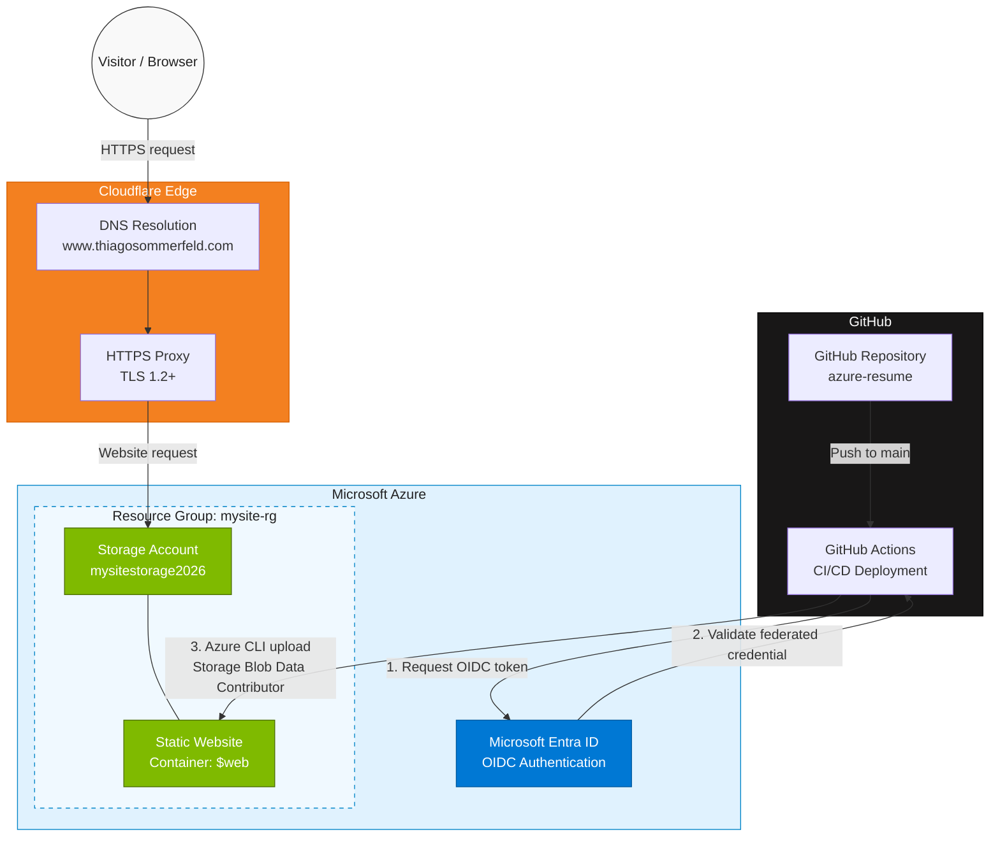

# Azure Cloud Resume Challenge

A personal cloud portfolio hosted on Microsoft Azure, featuring static website hosting, automated CI/CD with GitHub Actions, passwordless Azure authentication using OpenID Connect (OIDC), and a custom domain secured with HTTPS.

**Live website:** [www.thiagosommerfeld.com](https://www.thiagosommerfeld.com)

## Project Overview

This project demonstrates practical skills in cloud infrastructure, website deployment, identity and access management, and cloud security using Microsoft Azure.

The website is hosted on **Azure Storage Static Website** hosting. **GitHub Actions** automates deployments whenever changes are pushed to the `main` branch.

## Architecture

The solution consists of two main flows:

- **Website access:** Visitors access the custom domain through Cloudflare and reach the static website hosted on Azure Storage.
- **Automated deployment:** GitHub Actions authenticates to Azure using OIDC and uploads website files to the `$web` container.

### Architecture Diagram

## Challenges and Design Decisions

### 1. Custom Domain HTTPS and Certificate Management

**Challenge:** Azure Storage Static Website hosting does not natively provide HTTPS support for custom domains configured directly on the storage endpoint. Enabling HTTPS for a custom domain through Azure-native services, such as Azure Front Door, would introduce additional costs that were not justified for this small personal portfolio. Azure CDN was also considered, but its availability for this hosting scenario was limited by the retirement of the relevant offering.

**Decision:** Cloudflare was selected to provide DNS management, proxying, and HTTPS termination for the custom domain. This approach allowed the project to use its own domain with HTTPS while keeping infrastructure costs low.

**Trade-off:** The solution introduces a third-party dependency and does not provide the same origin certificate validation guarantees as a fully configured Azure Front Door architecture. Azure Front Door remains a potential future improvement if the project's security requirements or traffic justify the additional cost.

### 2. Choosing the Static Website Hosting Platform

**Challenge:** Several hosting options were evaluated for deploying a simple serverless static website:

- **Azure App Service:** A capable application hosting platform, but considered unnecessarily complex and potentially more expensive for a website that only requires static file hosting.
- **Azure Static Web Apps:** A suitable alternative with static hosting and additional web application capabilities.
- **Azure Storage Static Website:** A lightweight and cost-conscious option for serving static HTML, CSS, and JavaScript files.

**Decision:** Azure Storage Static Website was selected to gain practical experience with Azure Storage, identity and access management, RBAC, Azure CLI, and automated deployments through GitHub Actions.

**Trade-off:** This option requires additional configuration for custom-domain HTTPS and does not provide all the integrated application features available in Azure Static Web Apps.

**Future consideration:** The project could migrate to Azure Static Web Apps if integrated application features, a different deployment model, or a more suitable custom-domain configuration becomes beneficial. The current architecture keeps this option open.

## Deployment Workflow

The deployment process is automated through GitHub Actions.

1. Website source files are maintained in this GitHub repository.
2. A push to the `main` branch triggers the GitHub Actions workflow.
3. GitHub Actions obtains an OIDC token.
4. Microsoft Entra ID validates the federated identity configuration.
5. GitHub Actions authenticates to Azure without using a stored client secret.
6. Azure CLI uploads the website files to the `$web` container.
7. The updated website is served through the custom domain.

The workflow can also be triggered manually using `workflow_dispatch`.

## Security Practices

Security is an important part of this project. The current implementation includes the following controls:

- **Passwordless CI/CD authentication:** OIDC federated credentials are used instead of a long-lived client secret.
- **Least-privilege access:** The deployment identity has the `Storage Blob Data Contributor` role scoped to the `$web` container.
- **Storage account key access disabled:** Authentication using account access keys is disabled.
- **Anonymous Blob access disabled:** Anonymous Blob access is disabled at the storage account level.
- **HTTPS:** The public website is accessible over HTTPS through the custom domain.
- **Secure transfer required:** The storage account requires secure data transfer.
- **Minimum TLS version:** TLS 1.2 is configured as the minimum supported version.
- **Secret scanning:** GitHub Secret Scanning reported no alerts at the time of the latest review.
- **Multi-factor authentication:** GitHub account two-factor authentication is enabled.

The GitHub Actions workflow uses GitHub repository secrets for the Azure configuration values required by `azure/login`, including the application client ID, tenant ID, and subscription ID. Authentication itself is performed through OIDC rather than a stored client secret.

> **Architecture note:** Cloudflare provides DNS and proxy functionality for the custom domain. For a more robust Azure-native custom-domain HTTPS configuration, Azure Front Door or another suitable CDN can be evaluated as a future improvement.

## Technologies

- **Microsoft Azure Storage** — static website hosting
- **Azure CLI** — automated file uploads
- **Microsoft Entra ID** — identity and federated authentication
- **OpenID Connect (OIDC)** — passwordless CI/CD authentication
- **Azure Role-Based Access Control (RBAC)** — access management
- **GitHub Actions** — continuous integration and deployment
- **Git and GitHub** — version control and source code management
- **Cloudflare** — DNS and HTTPS proxying
- **HTML, CSS** — website technologies

## Lessons Learned

This project has provided hands-on experience with:

- Hosting and publishing static websites in Azure.
- Automating deployments using GitHub Actions.
- Configuring federated identity authentication with OIDC.
- Applying least-privilege access through Azure RBAC.
- Disabling storage account key access and anonymous Blob access.
- Configuring custom domains, HTTPS, and cloud security controls.
- Documenting cloud infrastructure and deployment workflows.

---

Built by **Thiago Sommerfeld** as part of my ongoing journey into **Cloud Engineering and Cyber Security**.
